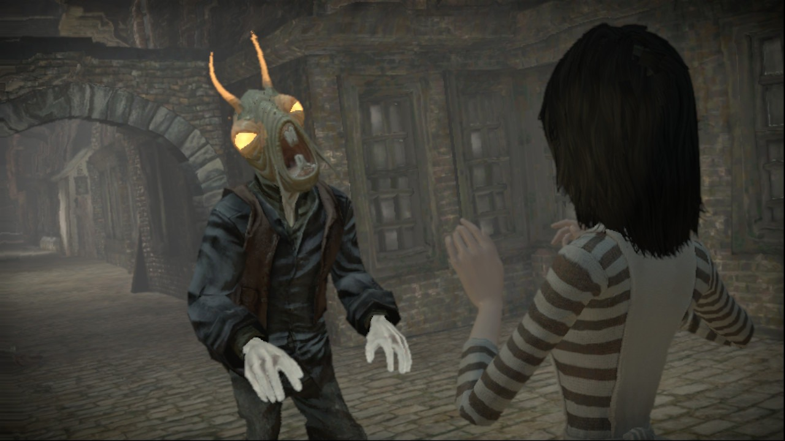
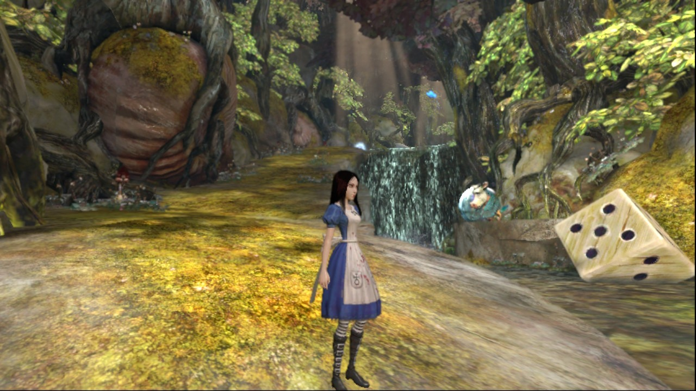
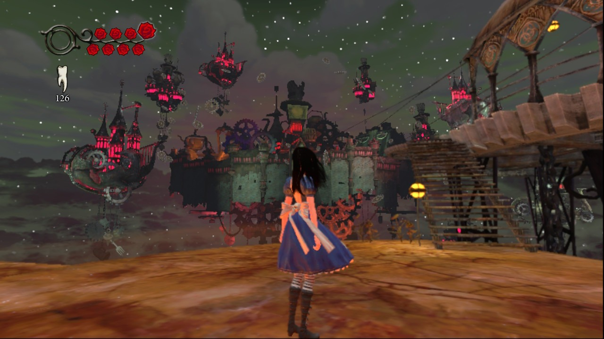
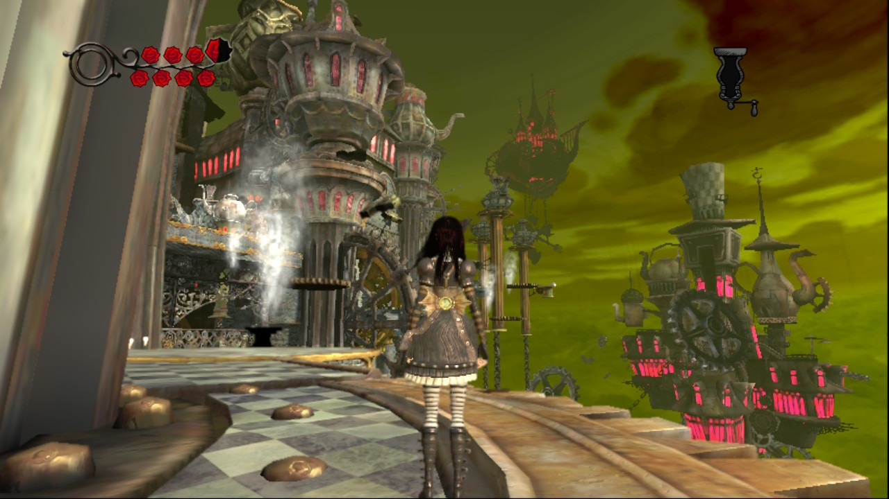

# alice-nx

An unofficial, fan-made port of the Xbox 360 game **Alice: Madness Returns** to the **Nintendo Switch**,
made by static recompilation with [ReXGlue](https://github.com/rexglue/rexglue-sdk). Built on
[sa2-nx](https://github.com/ChanseyIsTheBest/sa2-nx) and started from [mhnwis-nx](https://github.com/adumah/mhnwis-nx).

> [!IMPORTANT]
> **This repository contains no game.** No game files, no game code (translated or not), no shaders, no assets and no
> ready-made NRO. **You need your own copy of the game** (the Xbox 360 disc, dumped by you) and you build the port from
> it on your own computer. See [Disclaimer](#disclaimer).

> [!WARNING]
> **Beta.** The game is playable on a real Switch (tested from the start into Chapter 2, the Hatter's Domain), but it
> is not finished: some textures and effects are drawn wrong (see [Known issues](#known-issues)), and it runs at
> **about 29.5 fps on average** (a 30 fps cap, with dips to about 21 in the busiest scenes). Unreal Engine 3 is hard
> to recompile for the Switch: its game thread is heavy CPU work, and the console's CPU is the limit in most scenes.

## Screenshots

Taken on a Switch Lite (handheld) with this port.

| | |
|---|---|
|  |  |
|  |  |

## How it works

The PowerPC code of the game's `default.xex` is translated to C++ by ReXGlue and compiled for the Switch's ARM CPU. It
is not an emulator. The game is drawn natively on the Switch's own graphics API, **deko3d**, by Renut, a
Direct3D-level renderer (from [reNut](https://github.com/masterspike52/reNut), through banjo-nx and sa2-nx): the
game's Direct3D calls are replaced by native ones, and its Xbox 360 shaders are translated ahead of time on your PC.

## Overclock

> [!CAUTION]
> **This port raises the console's clocks while the game runs**, because the game needs it:
>
> | | Stock | This port |
> |---|---|---|
> | CPU (docked and handheld) | 1020 MHz | **1785 MHz** (an overclock) |
> | GPU (handheld) | 307.2-460.8 MHz | **768 MHz** (the console's docked clock) |
> | Memory (handheld) | 1331.2 MHz | **1600 MHz** (the console's docked clock) |
>
> Docked, the GPU and memory are left as they are. The clocks go back when the game closes. Expect **more heat and a
> shorter battery life**. Use it at your own risk. To turn the overclock off, put these lines in `alice.toml` next to
> `alice.nro` (the game is then slower):
>
> ```toml
> alice_cpu_mhz = 0            # the CPU is not touched
> alice_handheld_gpu_mhz = 460 # the official 460.8 MHz handheld profile, nothing held
> ```

## Performance settings

The Switch build changes some of the game's own graphics settings to keep the frame rate up. All of them are
switches you can change in `alice.toml` (shown with the Switch default):

| Setting | Default | What it does |
|---|---|---|
| `alice_screen_percentage = 66.7` | 480p | The 3D scene at 854x480, scaled up to 720p (the HUD stays at 720p). `100` = the full 1280x720. |
| `alice_shadows = false` | off | The game's dynamic shadows. |
| `alice_foliage_distance = 0.5` | half | How far grass and plants are drawn. |
| `alice_motion_blur = false`, `alice_radial_blur = false`, `alice_depth_of_field = false` | off | The blur effects. |
| `alice_composite_lights = true` | on | Folds unshadowed lights into the cheaper light environments. |
| `alice_decals = true` | on | Decals (needed for the Shrink sense's hidden drawings). |

Other improvements, all borrowed from the ports in [Credits](#credits):
- **No shader stutter:** every shader variant the game can draw with is compiled on your PC into
  `deko3d_shaders.bin`, so the console compiles none while you play (the idea from mk9-nx's build-time shader cache).
- **Faster game code:** the recompiled code skips the Xbox 360's interrupt fences and keeps several PowerPC registers
  in native ones (`skip_msr` and the register locals, from sa2-nx, masseffect-nx and mk9-nx).
- Critical sections spin briefly before they wait (`kernel_critsec_spin = 1024`, from mk9-nx).

## Language

The languages come from **your own copy of the game**, not from this port. The disc this port was made with has
English, German, Spanish (Spain), French, Italian and partly Japanese. The game uses the console language set by
`user_language` in `alice.toml` (Xbox 360 language IDs):

```toml
user_language = 5   # 1 English (default), 2 Japanese, 3 German, 4 French, 5 Spanish, 6 Italian
```

Not tested yet in a language other than English: reports are welcome.

## Known issues

- An oil decal on the floor can show as a square near Alice.
- Frame rate dips to about 21 fps in the busiest scenes (forests with many objects).
- Once, Alice's body (not her head and arms) was not drawn after a long session; it was not seen again since.
- Colours are slightly brighter and less saturated than on the Xbox 360.
- Some floor and light-shaft effects are drawn wrong in places.

## What you need

- **Your own copy of the game**: the Xbox 360 disc, dumped by you, as an extracted folder holding `Default.xex` or as
  an `.iso`. `Default.xex` must be title ID `45410916`, media ID `31C4B45C`, version 2 (the code generator prints
  these).
- **A Switch with custom firmware** (Atmosphère) and about 5 GB free on the SD card (the game files are 4.5 GB).
- **A Linux PC (x86-64) to build on**: nothing is played on it. With clang, CMake 3.25 or newer, Ninja, Python 3, Git,
  the X11/XCB and Wayland development files, and [devkitPro](https://devkitpro.org/) (devkitA64, libnx, deko3d,
  switch-tools).
- About 10 GB of free memory to compile (the translated game is ~247 MB of C++; `-j 4`), and about 20 GB of disk.
- [sa2-nx](https://github.com/ChanseyIsTheBest/sa2-nx) next to this repository, at commit
  `adf3a4eee524dcca5cd7c1b42454ddb8a09124a1` (the script below clones it): its SDK fork and tools are used to build.

## Building for the Switch

One command, from your disc to the SD card folder:

```sh
git clone https://github.com/adumah/alice-nx.git
alice-nx/tools/build_from_disc.sh /path/to/your/extracted/disc   # or your .iso
```

It runs every step below, each skipped when it is already done, so it can be run again after an error. It takes a few
hours. The result is `out/nx/sdcard/switch/alice-nx`:

```text
/switch/alice-nx/
  alice.nro
  deko3d_shaders.bin     (every shader, compiled for the console from your copy)
  game_root/             (your game files)
  alice.toml             (your settings; optional)
  logs/                  (written by the game)
```

Copy `out/nx/sdcard/switch` to the root of the SD card. Start the game from the homebrew menu opened **through a game**
(hold R while starting a game), not from the album: album mode does not give the game enough memory.

The steps, if you want to run them yourself:

```sh
tools/build_sdk.sh                        # the code generator (once)
mkdir -p assets && ln -s /path/to/your/extracted/disc assets/game_root
tools/codegen.sh                          # translate the game's code (about 5 minutes; app/generated/, never committed)
tools/renut/extract_shaders.sh            # every shader from the game's packages
tools/host_shaders.sh -j 4                # the shaders, translated on the PC (no PC game is built)
tools/deko3d_build_tools.sh               # the shader compilers for the Switch (once)
tools/renut/switch_shaders.sh             # the shaders in their Switch form
python3 -I tools/renut/precompile_all_variants.py --jobs 4   # deko3d_shaders.bin (the longest step)
tools/build_switch.sh                     # out/nx/alice.nro
tools/package_switch.sh --with-game       # the SD card folder
```

## Notes for developers

Analysis notes, with the evidence for every correction: [docs/alice-notes.md](docs/alice-notes.md) and
[docs/d3d-census.md](docs/d3d-census.md). Code-generator corrections: [app/overrides.toml](app/overrides.toml).
`tools/send_switch.sh` sends a fresh `out/nx/alice.nro` to a Switch in the homebrew menu's netloader and shows the
game's log on the PC.

## Disclaimer

This is an unofficial, non-commercial fan project for preservation and personal use. It is not affiliated with,
endorsed by, sponsored by or connected to Electronic Arts, Spicy Horse, American McGee, Microsoft or Nintendo.

*Alice: Madness Returns* and all related titles, characters, names, logos and marks belong to their respective owners.
Xbox 360 is a trademark of Microsoft; Nintendo Switch is a trademark of Nintendo. The screenshots above show the game
running with this port, for illustration only. The fallback homebrew menu icon (`app/switch/icon.jpg`,
`tools/make_icon.py`) is original artwork drawn from plain shapes, with no art from the game.

This repository contains **no part of the game**: no disc files, no assets, no executable, no shaders, and none of the
C++ the code generator produces from the game (`app/generated/` is never committed). It holds only this project's own
code, build scripts and analysis notes (addresses and descriptions of the game's code, needed to translate it
correctly). **Everyone needs their own copy of the game.** Builds made from it contain the game's translated code
and shaders: they are for your own use only. **Do not share them, and do not ask for or share game files, NROs or
download links.**

Running homebrew requires custom firmware, which goes against Nintendo's terms of service and can get a console
banned. The overclock (see [Overclock](#overclock)) runs the console above its stock clocks. Both are your own
choice and risk.

## Credits

- **[American McGee](https://en.wikipedia.org/wiki/American_McGee)**, the creator of the *Alice* games.
- **Spicy Horse**, who developed *Alice: Madness Returns*, and **Electronic Arts**, who published it. All credit for
  the game itself goes to them.
- **[ReXGlue SDK](https://github.com/rexglue/rexglue-sdk)**, which turns Xbox 360 code into C++ and provides the
  runtime it runs on. ReXGlue builds on the [Xenia](https://github.com/xenia-project) emulator.
- **ChanseyIsTheBest**, the creator of **[sa2-nx](https://github.com/ChanseyIsTheBest/sa2-nx)**: the porting guide, the
  SDK fork, the tools, the Switch platform layer, the clock handling and the Renut renderer this port uses.
- **Thorhax**, the creator of **[mk9-nx](https://github.com/Thorhax/mk9-nx)** (Mortal Kombat 9, Unreal Engine 3 like
  this game): the optimised codegen settings, the critical-section spin and the build-time shader cache idea.
- **[reNut](https://github.com/masterspike52/reNut)** by masterspike52, the Direct3D-level renderer, and **banjo-nx**,
  which gave it its deko3d back end.
- The other Unreal Engine 3 ports whose notes guided this one:
  [masseffect-nx](https://github.com/nebadasSwifty/masseffect-nx) by nebadasSwifty and
  [gears2-nx](https://github.com/VasilkovND/gears2-nx) by VasilkovND.
- **[mhnwis-nx](https://github.com/adumah/mhnwis-nx)**: the project this one started from.
- [devkitPro](https://devkitpro.org/) ([libnx](https://github.com/switchbrew/libnx),
  [deko3d](https://github.com/devkitPro/deko3d), [uam](https://github.com/devkitPro/uam)),
  [plume](https://github.com/renderbag/plume) and [XenosRecomp](https://github.com/hedge-dev/XenosRecomp).

Full notices and licenses: [THIRD_PARTY_NOTICES.md](THIRD_PARTY_NOTICES.md).

## License

GPL-3.0 (see [LICENSE](LICENSE)), because this project includes code adapted from sa2-nx and mhnwis-nx. The game
itself is not covered: it is not here, and it belongs to its owners.
